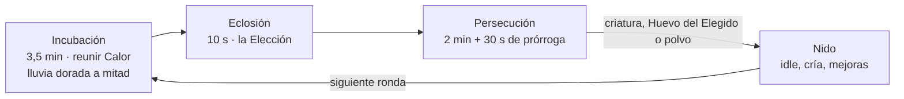

# GDD — THE EGG CHOOSES (El Huevo Elige) para Roblox

Versión 2 · 2026-10-23 · Adrian (v1: 2026-10-21)

> **Qué cambia en la versión 2.** Tras jugar miles de rondas con el simulador de bots se vio que la v1 tenía fallos de fondo:
> - la incubación (8 min) casi no decidía quién ganaba;
> - el premio era demasiado escaso;
> - la ronda tenía mucho tiempo muerto;
> - había pago por ganar;
> - los AFK estropeaban la ronda.
>
> La v2 corrige esas mecánicas. Los resultados, en 30 días simulados con 72 jugadores y las mismas horas de juego:
>
> | | v1 | v2 |
> |---|---|---|
> | Duración de la ronda | ~12,8 min | ~5,8 min |
> | Victorias por hora de juego (media) | 0,5 | 2,3 |
> | Sesiones que acaban con alguna victoria | 24 % | 69 % |
> | Victorias por hora de un novato | 0 | 0,35 |
> | Victorias por hora de un jugador casual | 0,02 | 0,9 |
> | El elegido conserva su criatura (12 jugadores) | 10 % | ~33 % |
> | Robos por criatura (12 jugadores) | 9,3 | ~3,4 |
> | Nuevas generaciones al mes (jugador muy activo) | 2 | 2 |
>
> Las secciones afectadas están marcadas con **(v2)**. La lista de cambios y el porqué de cada uno están en la sección 12.

## 1. Resumen ejecutivo

**The Egg Chooses** es un juego social de 10 a 16 jugadores por servidor donde todo el servidor alimenta un único huevo gigante, el huevo elige a un dueño al eclosionar y el resto intenta robárselo. Junta en una sola partida los tres motores que dominan Roblox en 2026: robar (Steal a Brainrot, Steal an Egg), revelar con suerte (lucky blocks, RNG) y cooperar bajo presión (99 Nights in the Forest).

**Pitch en una frase (para TikTok):** "Todo el servidor cuida UN huevo. Cuando nace, elige a UNA persona. Los demás tienen 2 minutos para robárselo."

**Género:** social party + idle/coleccionismo + persecución asimétrica. **Plataformas:** móvil primero (la mayoría del público de Roblox), PC, consola (Xbox, PlayStation). **Duración de ronda (v2):** unos 6 minutos. **Sesión objetivo:** 35 a 45 minutos (6 o 7 rondas). **Clasificación objetivo:** apto para todas las edades (violencia nula; robar = agarrar y cargar, nunca pegar).

### Pilares de diseño

1. **Un servidor, un evento.** Cada ronda es un momento colectivo con cuenta atrás compartida; nadie juega solo aunque juegue solo.
2. **La suerte se ve.** La eclosión es un momento de 10 segundos que todo el servidor mira a la vez; está diseñada para grabarse. **(v2)** Antes duraba 30 s: demasiado tiempo sin poder hacer nada.
3. **Drama sin crueldad.** El robo genera persecuciones y alianzas, pero perder nunca quita progreso permanente: el perdedor se lleva consuelo (polvo de cáscara).
4. **Tu nido crece aunque no estés.** Las criaturas producen ingresos por segundo y dan razón para volver cada día.
5. **Cada criatura es única.** Se generan combinando genes (cuerpo, cabeza, patrón, aura, mutación), así cada jugador tiene algo que nadie más tiene.

### Qué lo hace novedoso

En los juegos de robar actuales cada jugador roba a otro de forma individual. Aquí el botín es **escaso y compartido** (una criatura por cada pocos jugadores), nace de un esfuerzo colectivo y la elección del dueño es pública y dramática. Eso convierte cada ronda en una historia con protagonista, traidores y giro final: exactamente el formato que funciona en clips cortos.

## 2. Tendencias de Roblox y oportunidad

En 2026 los juegos que explotan en meses combinan bucles rápidos, suerte visible y juego con amigos; los clásicos de roleplay sostienen el tráfico diario. Según el ranking de junio de 2026 de [RoWatcher](https://rowatcher.com/news/the-most-popular-roblox-games-right-now-ranked-by-live-players), los formatos de simulación e idle/RNG dominan los jugadores simultáneos, y la ola viral (Steal a Brainrot, 99 Nights in the Forest, Fish It, Sell Lemons, Kick a Lucky Block) llegó arriba en meses, no en años.

| Juego | Formato | Dato | Lección para nosotros |
|---|---|---|---|
| [Steal an Egg](https://rblxstat.com/lists/best-roblox-games) | Robar huevos | ~812.000 jugadores en vivo a principios de octubre de 2026, primero del ranking de RBLXSTAT | Robar un huevo es el gancho del momento; nosotros lo convertimos en un evento colectivo |
| [Steal a Brainrot](https://en.wikipedia.org/wiki/Steal_a_Brainrot) | Robar + idle | Pico de 25,4 millones de usuarios simultáneos en octubre de 2025; #2 en visitas de la historia | Ingresos por segundo + robo = adicción; cuidado con la propiedad intelectual (su estudio demandó a un clon) |
| [99 Nights in the Forest](https://rowatcher.com/news/the-most-popular-roblox-games-right-now-ranked-by-live-players) | Supervivencia cooperativa | ~285.000 jugando en junio de 2026; 27.200 millones de visitas | La cooperación con tensión retiene grupos de amigos |
| [Kick a Lucky Block](https://rowatcher.com/news/the-most-popular-roblox-games-right-now-ranked-by-live-players) | Clicker RNG | ~107.000 jugando en junio de 2026 | Las revelaciones de suerte disparan jugadores simultáneos |
| [Jujutsu Shenanigans](https://rblxstat.com/lists/trending-roblox-games) | Combate anime | Líder de crecimiento semanal (10 de octubre de 2026) | El combate crece rápido, pero es caro de producir |

**Tendencias que aprovechamos:**

- **El robo como motor social.** Steal a Brainrot y Steal an Egg demuestran que quitarle algo a otro jugador genera reacciones y clips.
- **RNG visible y compartido.** Lucky blocks y la "suerte de servidor" de los simuladores convierten la suerte en espectáculo.
- **Formatos cortos y legibles.** Juegos tipo "+1 velocidad" y obbys rápidos se entienden en 3 segundos de miniatura.
- **Coop con presión de tiempo.** Las noches de 99 Nights crean ritmo de tensión y alivio.

**Cambio de plataforma clave:** en abril de 2026 Roblox anunció que su sistema de descubrimiento priorizará la **retención a largo plazo** y añadió una sección "Standout Games" en la página de inicio para juegos "novedosos" en género, mecánica o estilo visual ([Net Influencer](https://www.netinfluencer.com/roblox-to-raise-developer-exchange-rate-for-games-aimed-at-18-plus-players-as-adult-cohort-surges/)). Un clon puro de Steal a Brainrot ya no basta: necesitamos un giro propio y razones para volver cada día. The Egg Chooses apunta a ambas cosas.

**Riesgo de mercado:** la ola de "robar X" puede saturarse antes del lanzamiento. Mitigación: el gancho comunicado no es "robar" sino "el huevo elige"; el robo es la consecuencia.

## 3. Público objetivo y fantasía del jugador

El núcleo son jugadores de 9 a 15 años que juegan en móvil con amigos; el segundo objetivo son creadores de contenido de 16 a 25 años que buscan momentos de reacción.

| Segmento | Qué busca | Cómo lo servimos |
|---|---|---|
| Coleccionista (9-13) | Tener la criatura más rara, enseñarla | Genes únicos, nido decorable, tabla de rarezas |
| Competitivo (12-16) | Ganar, robar, presumir | Persecución, ranking semanal de robos, títulos |
| Social (9-15) | Jugar con amigos, bromear | Alianzas, emotes, traiciones, servidores privados |
| Creador de contenido (16-25) | Momentos que dan reacción | Eclosión en directo, "el huevo me eligió", robos en el último segundo |

**Fantasía central:** "Fui el elegido" o "se lo robé al elegido". Las dos son igual de satisfactorias, por eso nadie se aburre aunque no sea el elegido.

**Fantasía secundaria:** criar una colección rara que crece sola y que otros envidian al visitar tu nido.

## 4. Core loop y bucles de juego (v2)

La ronda de unos 6 minutos es el bucle central; el nido convierte cada ronda en progreso permanente y da motivos para volver.

Ganar o perder la persecución siempre alimenta el nido: criatura para quien la mete en su nido, Huevo del Elegido para el elegido que la pierde y polvo de cáscara para el resto (si participó).

**Por qué se acortó (v2).** En la v1 la ronda duraba ~12,8 min y en una sesión de 35-45 min solo cabían 3 rondas, con una criatura para todo el servidor. El 76 % de las sesiones acababa sin ganar nada. Con rondas de 6 min y varias criaturas por ronda, el 69 % de las sesiones tiene al menos una victoria.

### Bucles por escala

| Escala | Qué hace el jugador | Qué le hace volver |
|---|---|---|
| Ronda (6 min) | Recoger Calor, ver la eclosión, perseguir o huir | El próximo huevo puede ser más raro |
| Sesión (35-45 min) | 6-7 rondas, mejoras del nido, iniciar crías | Un huevo personal a punto de nacer |
| Día | Misiones diarias, racha, cobrar la producción sin conexión | Racha de 7 días, crías de hasta 4 h |
| Semana | Luna de Sangre, actualización del sábado, ranking de robos | Genes nuevos y campeón de la semana |
| Temporada (6 semanas) | Pase de temporada, bioma nuevo | Genes exclusivos que no vuelven |

## 5. Mecánicas detalladas

Cada mecánica sirve a una de las cuatro fases de la ronda; todas se aprenden en menos de 60 segundos y se juegan con un solo botón de acción en móvil.

### 5.1 Calor (recurso de ronda)

- El Calor se genera en **fuentes de calor** repartidas por el mapa: brasas que se recogen, géiseres que hay que activar en equipo, luciérnagas que se cazan y bloques de suerte que sueltan de 1 a 50 de Calor.
- Cada jugador lleva una **bolsa** con capacidad limitada (100 al inicio, ampliable con Monedas). Hay que volver al huevo para depositar: eso crea tráfico y encuentros. **(v2)** Ningún pase da más capacidad.
- Depositar Calor suma **Afinidad** personal con el huevo, llena la **barra del servidor** y **(v2)** da **escudos** para la persecución (5.4).
- **(v2) Lluvia de brasas doradas:** a mitad de la incubación, durante 25 s, las brasas valen el doble. Es un objetivo común en mitad de la fase más larga, para que no sea siempre "recoger y llevar".
- Mientras llevas la bolsa llena brillas: los demás pueden empujarte para que caiga parte del Calor (no se roba la bolsa entera). **(v2)** Tras un empujón tienes 6 s de protección, nadie puede empujar a la misma persona más de una vez cada 30 s y los novatos no pueden ser empujados en sus 5 primeras rondas. Así no se convierte en acoso a los nuevos.

### 5.2 El Huevo Gigante

- Está en el centro del mapa, visible desde todas partes, y cambia de aspecto según lo que recibe: color, grietas, sonido de latido.
- **Ofrendas:** además de Calor, se pueden depositar objetos raros encontrados en el mapa (cristal, pluma, hueso). Cada ofrenda sesga un gen de la criatura: el cristal aumenta la probabilidad de cuerpo cristalino, etc. Esto da profundidad a los jugadores veteranos.
- **Umbrales de servidor:** al llegar al 25 %, 50 %, 75 % y 100 % de la barra, la rareza mínima garantizada sube y suena un aviso para todo el servidor. La meta de la barra está pensada para que acabe de media entre el 55 % y el 70 %.

### 5.3 La Elección (v2)

- **Varias criaturas por ronda.** El huevo suelta una criatura más por cada 5 perseguidores, hasta 3: con 2-6 jugadores sale 1; con 7-11, 2; con 12 o más, 3. Cada una elige a un jugador distinto. Esto sustituye al evento "Huevo Doble" de la v1: con una sola criatura para 12 jugadores, la persecución era 11 contra 1 y el elegido solo la conservaba el 10 % de las veces.
- La probabilidad de cada jugador = su Afinidad / Afinidad total del servidor, con un mínimo del 2 % para todos. Cualquiera puede ser elegido, y eso alimenta los clips de "no puse nada y me eligió". El mínimo sube un 2 % por cada ronda sin ser elegido, hasta un 12 % ("suerte acumulada").
- **(v2) Novatos:** en su primera ronda, un jugador nuevo ya tiene ese 12 %.
- **(v2) Inactivos:** solo pueden ser elegidos quienes depositaron algo o se movieron en el último minuto. Si el huevo elegía a alguien AFK, se la robaban al instante y la ronda perdía la gracia.
- **(v2) 10 segundos, sin bloquear la cámara:** el huevo se agrieta y un foco salta entre los 5 favoritos hasta pararse en cada elegido. Mientras, todos pueden moverse y colocarse.
- El elegido recibe un aura dorada, una correa con la criatura y una flecha hacia su nido.

### 5.4 Persecución y robo (v2)

- **Duración:** 2 minutos. Cada elegido debe llevar su criatura a su nido y **asegurarla** (aguantar 30 s seguidos dentro) o tenerla dentro al acabar el tiempo. Si no está en su nido, empieza una **prórroga** de 30 s: gana el primero que la meta en el suyo.
- **Robar (v2): un toque y un tira y afloja.** Tocar el botón junto al portador empieza un tira y afloja de 1,5 s (2,25 s si el portador está en su nido). El ladrón tiene que seguir cerca todo ese tiempo y el portador lo rompe si se aleja. En la v1 había que *mantener* el botón mientras los dos os movíais, algo muy incómodo en móvil, que es la mayoría del público.
- **Escudos de Afinidad (v2):** cada 800 de Calor depositado en la ronda da un escudo (máximo 1). Si te van a quitar la criatura y tienes escudo, se rompe y el robo no ocurre. Así la incubación también cuenta en la persecución: en la v1, recoger Calor 8 minutos solo daba probabilidad de ser el *primer* portador.
- **Una criatura por persona:** quien lleva una no puede robar otra, y quien ya ha ganado una en la ronda no persigue más. Así cada portador tiene sus propios perseguidores.
- **Defensa:** el portador tiene un esprint con recarga y puede pasar la correa a un aliado libre (pase de relevo). Los nidos tienen una puerta que se cierra 10 segundos una vez por ronda. En su nido, el portador va a velocidad normal y los intrusos van más lentos.
- **Equilibrio:** el portador corre un 10 % más lento fuera de su nido. Cada robo da 3 s de inmunidad al nuevo portador y deja aturdido 2 s al que la pierde. Los elegidos empiezan con 10 s de inmunidad y 4 s de ventaja.
- **Ladrones del bosque (v2):** en servidores con menos de 6 jugadores salen zorros del borde del mapa que persiguen a los portadores. Si ganan el tira y afloja, la criatura cae al suelo y cualquiera puede recogerla; nunca se la quedan. Dan tensión a los servidores pequeños, que son lo normal al lanzar. Son claramente criaturas del juego, no jugadores falsos.
- **Alianzas:** botón "Ofrecer trato": si un aliado te ayuda y ganas, recibe el 30 % del polvo de cáscara y una copia común de la criatura. Es opcional y se puede traicionar.

### 5.5 Consuelo

- Todos los que no se quedan con una criatura reciben **Polvo de cáscara** según su Afinidad y sus intentos de robo. **(v2)** Quien no hizo nada en la ronda no cobra. Con el polvo se compran huevos pequeños personales y decoración.
- **(v2) Huevo del Elegido:** el elegido que pierde su criatura recibe 50 de polvo extra y un huevo de Rara a Épica. Ser elegido nunca es una pérdida.

### 5.6 Nido personal

- Parcela propia dentro de cada servidor (como en los tycoons), cargada desde tus datos guardados.
- Las criaturas generan **Monedas por segundo** según su rareza y genes, también sin conexión (al 25 %, con tope de 8 horas).
- Se puede **decorar** (12 piezas de Monedas o polvo, solo estéticas) y visitar. Los nidos ajenos se pueden ver; solo se pueden saquear en la Noche de Saqueo (sección 7). Las criaturas sobrantes se pueden **liberar** a cambio de polvo.
- **(v2) Favoritas:** hasta 3 criaturas con ⭐. No se liberan por error, sobreviven a la Nueva generación y la primera te acompaña flotando durante la ronda (solo estética). Así el nido también se ve en la ronda.
- **(v2) Huevo de bienvenida:** la primera vez, además de una criatura de regalo, un huevo que nace en 2 minutos, para que el novato vea pronto el ciclo del nido.

### 5.7 Genes y cría

- Cinco ranuras de genes: Cuerpo, Cabeza, Patrón, Aura y Mutación. Cada gen tiene rareza propia; la rareza global de la criatura sale de la combinación.
- Rarezas: Común, Rara, Épica, Legendaria, Mítica y **Secreta**. **(v2)** La Secreta es de 1 entre 50.000 (antes 1 entre 1.000.000). Con el volumen real de eclosiones, el anuncio global de "¡alguien sacó una Secreta!" tardaría meses en ocurrir, y es uno de los ganchos virales. Se ajustará con datos reales.
- **Cría:** dos criaturas del nido producen un huevo personal que hereda genes de ambos padres con probabilidad de mutación. Tarda tiempo real (de 10 min a 4 h), lo que crea citas de vuelta.
- Todas las criaturas son diseños propios: nada de personajes del meme "Italian Brainrot" ni de otras propiedades intelectuales.

## 6. Progresión, economía y contenido

La economía tiene tres monedas con funciones separadas, para que la ronda (habilidad y suerte) y el nido (paciencia) no se canibalicen.

| Moneda | Cómo se gana | En qué se gasta | ¿Se compra con Robux? |
|---|---|---|---|
| Calor | Recogiendo en la ronda | Se deposita en el huevo; se pierde al acabar la ronda | No |
| Polvo de cáscara | Consuelo, robos, misiones | Huevos personales, ofrendas, ampliar bolsa | Solo en packs pequeños |
| Monedas | Producción del nido por segundo | Mejoras del nido, cría, decoración, habilidades | Sí (packs) |

### Mejoras permanentes (con Monedas)

1. **Bolsa:** capacidad de 100 a 1.000 Calor en 10 niveles.
2. **Botas:** velocidad base +1 % por nivel (tope +10 %, para no romper la persecución).
3. **Olfato:** marca en el mapa las fuentes de Calor más ricas.
4. **Nido:** más ranuras para criaturas (de 6 a 40) y multiplicador de producción.
5. **Incubadora:** acorta los tiempos de cría.

### Rebirth ("Nueva generación")

Al llegar a 40 criaturas y un umbral de Monedas, el jugador puede reiniciar el nido (**v2:** conservando sus 3 favoritas) a cambio de un multiplicador permanente de producción y un **gen exclusivo de generación** (por ejemplo, un aura que solo tienen los de Generación 5). Es la meta larga de los jugadores dedicados y un objeto de estatus visible.

### Misiones y retención diaria

- **3 misiones diarias** ("roba la criatura 1 vez", "deposita 500 de Calor", "cría 2 huevos").
- **Racha diaria** de 7 días con un huevo especial al final.
- **Pase de temporada gratuito** de 30 niveles cada 6 semanas, con carril premium opcional (ver Monetización).
- **Códigos** publicados en redes y Discord: pequeñas cantidades de Polvo y potenciadores.

### Plan de contenido

| Lanzamiento | Contenido |
|---|---|
| Día 1 | 1 mapa (Bosque de Brasas), 60 genes, 6 rarezas, cría, 1 temporada |
| Cada semana | 1 actualización los sábados: nuevos genes, evento corto, equilibrio |
| Cada 6 semanas | Nueva temporada con bioma temático (Volcán, Glaciar, Luna, Ciudad Neón) |
| Fechas clave | Huevos de Halloween, Navidad, San Valentín y aniversario |

## 7. Social, multijugador y eventos

Lo social es el producto: cada sistema empuja a jugar con amigos, a hablar de lo que pasó y a invitar a otros.

### Sistemas sociales

- **Grupos de hasta 4** ("Bandada"): comparten el 10 % del Calor depositado (Afinidad) y se ven a través de las paredes. Con un amigo de Roblox en el grupo, +10 % de Polvo. **(v2)** No son aliados automáticos en la persecución (para eso están los tratos), para que cuatro amigos no sean imbatibles.
- **Pactos y traiciones:** el botón de trato (sección 5.4) registra cuántos pactos has cumplido o roto. Aparece en tu perfil como "Leal" o "Traidor", un título que la comunidad adora presumir.
- **Intercambio** de criaturas entre jugadores con ventana de confirmación doble, historial y valor estimado visible para reducir estafas.
- **Visitas de nido:** dar "me gusta" a nidos ajenos; los nidos más votados de la semana salen en un salón de la fama del lobby.
- **Emotes de reacción** asignados a la eclosión (sorpresa, lloro, baile) para que los clips tengan expresividad.

### Anuncios globales

- Cuando alguien consigue una criatura Mítica o Secreta, aparece un aviso en **todos los servidores** con su nombre. Genera FOMO y búsquedas del jugador en redes.

### Eventos

| Evento | Frecuencia | Qué pasa |
|---|---|---|
| Luna de Sangre | Cada sábado, 3 franjas de 1 hora (02:00, 12:00 y 20:00 UTC) **(v2)** para todas las zonas horarias | Huevos con rareza mínima Épica y persecución de 3 minutos |
| ~~Huevo Doble~~ **(v2)** | — | Sustituido por las varias criaturas por ronda (5.3), que funcionan siempre |
| Noche de Saqueo | Sábados y domingos, 21:00-23:00 UTC | **(v2)** Fase propia de 60 s tras los resultados (en la v1 competía con la incubación y partía el servidor). Se saquea una criatura de un nido ajeno si su dueño no está dentro. Versión prudente: el ladrón se lleva una copia común y el dueño no pierde nada (configurable). Las Secretas son inmunes |
| Huevo del Admin | Evento en directo semanal | El equipo entra en un servidor anunciado y siembra un huevo único; diseñado para que los streamers lo cubran |
| Huevo Comunitario | Mensual | Todos los servidores aportan Calor a una barra global; al llenarse, todos reciben una criatura conmemorativa |

### Seguridad y civismo

- Chat según las reglas y filtros de Roblox; emotes y frases rápidas para quienes no tienen chat activado.
- Nada de ataques: robar es tocar y aguantar cerca. Nunca hay daño ni muerte.
- Botón para silenciar o bloquear desde la propia persecución.

## 8. Mundo, arte, sonido y UX

El estilo debe reconocerse en una miniatura de 150 píxeles: un huevo enorme y brillante en el centro, colores saturados y siluetas simples.

### Mundo

- **Mapa de lanzamiento: Bosque de Brasas.** Mapa circular de unos 300 x 300 studs, con el huevo en un claro central y 16 nidos en el borde. Distancia nido-huevo: 25 a 35 segundos corriendo, suficiente para una persecución pero no aburrida.
- **Zonas:** pantano de luciérnagas, cueva de cristales, géiseres, puente colgante (atajo arriesgado) y túneles (rutas de escape para el portador).
- **Ciclo visual de la ronda:** atardecer durante la incubación, eclipse en la eclosión, noche iluminada por el aura de la criatura durante la persecución.

### Dirección de arte

- Estilo "juguete brillante": formas redondas, materiales suaves, emisivos fuertes para lo valioso (Calor, auras).
- **Lenguaje de rareza por color**, siempre igual: gris, verde, azul, morado, naranja, rojo y arcoíris para Secreta.
- Criaturas modulares (cuerpo + cabeza + patrón + aura): unas 60 piezas al lanzamiento dan miles de combinaciones con poco coste de arte.
- Rendimiento móvil: piezas de baja poligonización, partículas limitadas y texturas pequeñas.

### Sonido

- **Latido del huevo** que se acelera al llenarse la barra: es la firma sonora del juego y el audio de los clips.
- Cada rareza tiene un acorde de revelación distinto; la Secreta, una melodía exclusiva.
- Música dinámica: tranquila en incubación, tensa con percusión en la persecución.

### UX

- **Tutorial de 45 segundos** jugable dentro de la primera ronda: recoge, deposita, mira la eclosión. Nada de pantallas de texto.
- HUD mínimo: bolsa, barra del servidor, temporizador de fase y flecha de objetivo.
- Un botón de acción contextual en móvil (recoger / depositar / robar / pasar).
- Eclosión de 10 s sin bloquear la cámara **(v2)**, con botón "Captura" al final usando la captura de Roblox.
- Bajo la barra, lo que importa en cada momento de la persecución: la cuenta atrás del tira y afloja, el aviso "¡Te están robando!", los escudos y el progreso para asegurar.

## 9. Monetización

La estrategia combina cinco fuentes y nunca vende la victoria en la persecución: se paga por comodidad, estatus, velocidad de colección y momentos sociales. Roblox ofrece hoy suscripciones, compras en el juego, anuncios inmersivos (vídeo, imagen y portales) y recompensas por participación ([documentación de Roblox](https://create.roblox.com/docs/get-started/monetization)).

### 9.1 Game passes (pago único)

| Pase | Precio (Robux) | Qué da |
|---|---|---|
| Estela de Brasas **(v2)** | 99 | Rastro de chispas al correr (estético). Sustituye a la Bolsa Grande (+50 % de Calor), que era pagar por ganar: más Calor daba más probabilidad de ser elegido |
| Nido VIP | 249 | +10 ranuras, decoración dorada, etiqueta VIP |
| Auto-Depósito | 199 | El Calor se deposita solo al estar cerca del huevo |
| x2 Monedas | 299 | Duplica la producción del nido |
| Incubadora Rápida | 349 | Cría un 50 % más rápida |
| Ranura de Cría Extra | 149 | Dos crías a la vez |

### 9.2 Productos de consumo (developer products)

| Producto | Precio (Robux) | Notas de diseño |
|---|---|---|
| **Suerte del Servidor (15 min)** | 199 | Sube la rareza de los huevos de TODO el servidor y anuncia el nombre del comprador. Es la compra estrella: genera agradecimiento público y presión social sana |
| Ofrenda Dorada | 49 | Sesga un gen elegido en el próximo huevo del servidor |
| Reintento de Cría | 25 | Repite una cría con los mismos padres |
| Packs de Monedas | 49 a 999 | Escalado clásico con bonus en packs grandes |
| Huevo de Temporada | 99 | Probabilidades públicas antes de comprar |

### 9.3 Suscripción "Club del Nido"

Suscripción mensual (precio en moneda local, renovación automática) con: +20 % de Monedas, 1 Huevo de Temporada al mes, carril premium del pase de temporada, nombre de color en el chat y una decoración exclusiva cada mes. Es la base de ingresos recurrentes; se mide la tasa de cancelación en el panel de creador.

### 9.4 Anuncios

- **Vídeos con recompensa:** opcionales, nunca forzados. Ver un anuncio da un reintento de cría gratis o duplica el Polvo de consuelo de una ronda. Monetizan a la mayoría que no paga.
- **Anuncios inmersivos:** vallas en el lobby y portales de marca en zonas que no interfieren con el juego.
- **Integraciones de marca** (huevo patrocinado temático): fase posterior al éxito. Ojo: Roblox empezará a cobrar un porcentaje de estos acuerdos desde enero de 2027 ([Net Influencer](https://www.netinfluencer.com/roblox-to-raise-developer-exchange-rate-for-games-aimed-at-18-plus-players-as-adult-cohort-surges/)).

### 9.5 Otros ingresos

- **Servidores privados** de pago (para grupos de amigos y creadores que graban).
- **Ropa UGC oficial** del juego (camisetas "Fui el elegido", sombrero de cáscara).
- **Pase de temporada premium** (unos 399 Robux): carril con genes y decoraciones exclusivas.

### 9.6 Reglas de monetización ética

1. Ninguna compra garantiza ser elegido ni ganar la persecución, ni da ventaja en ellas. **(v2)** Se quitaron el Escudo de Cáscara de pago (bloqueaba un robo) y la Bolsa Grande (más Calor, más probabilidad de ser elegido). Los escudos ahora se ganan depositando Calor.
2. Todo lo aleatorio de pago muestra sus probabilidades antes de comprar.
3. Sin temporizadores falsos ni ventanas emergentes de compra tras perder.
4. Lo exclusivo de pago es cosmético o de comodidad; todo gen jugable se puede conseguir gratis.
5. Primera oferta al jugador nuevo solo tras su tercera ronda.

### 9.7 Objetivos económicos

| Métrica | Objetivo a 90 días |
|---|---|
| % de jugadores que pagan | 2-4 % |
| Ingresos por usuario diario (ARPDAU) | Medir en Robux y optimizar con pruebas A/B de precios |
| Peso de anuncios con recompensa en ingresos | 5-15 % |
| Suscriptores activos del Club | 0,5 % de usuarios mensuales |

## 10. Marketing y estrategia de viralización

La viralidad se diseña dentro del juego: cada ronda debe producir al menos un momento grabable de 15 segundos, y el marketing externo solo amplifica esos momentos.

### 10.1 Momentos virales diseñados

| Momento | Por qué se comparte | Formato ideal |
|---|---|---|
| "El huevo me eligió" | Sorpresa pura, sobre todo con poca Afinidad | Short vertical de 10-15 s con reacción |
| Robo en el último segundo | Giro final, euforia o rabia | Clip con temporizador visible |
| Traición en un pacto | Drama entre amigos | Storytime de 30-60 s |
| Criatura Secreta | Rareza 1 entre 50.000, anuncio global | Vídeo largo de "abrí X huevos" |
| Luna de Sangre en directo | Evento con hora fija | Directo en Twitch/YouTube |

### 10.2 Fase 1: Prelanzamiento (8 semanas antes)

- **Devlog en TikTok y YouTube Shorts** 3 veces por semana desde la cuenta del estudio: "construyendo un juego donde el huevo elige". Mostrar la ruleta de elección desde el primer vídeo.
- **Discord** con canal de ideas de genes: la comunidad vota criaturas que saldrán el día 1 (crea sentido de propiedad).
- **Pruebas cerradas** con 50-100 jugadores para grabar clips reales y ajustar el equilibrio.
- **Página del juego** publicada como "Próximamente" con botón de notificar y cuenta atrás.

### 10.3 Fase 2: Lanzamiento (semana 0-2)

- **Lanzamiento un viernes por la tarde** (hora de EE. UU.) para coincidir con el fin de semana escolar.
- **Siembra de creadores:** 20-40 creadores medianos (50.000 a 1 millón de suscriptores), en inglés y en español. Se les da acceso anticipado, un huevo con su nombre y un código propio. Los medianos convierten mejor y son más asequibles que los gigantes.
- **Anuncios patrocinados de Roblox** con presupuesto de prueba; se prueban al menos 4 miniaturas y 3 iconos distintos. Mantener el que tenga mejor tasa de clic y retención.
- **Evento de lanzamiento "Primer Huevo Secreto"**: el primer jugador en conseguir una Secreta recibe un título único y se anuncia en redes.

### 10.4 Fase 3: Crecimiento (mes 1-3)

- **Actualizaciones cada sábado** con nombre llamativo en el título (por ejemplo, "[🌋 VOLCÁN] The Egg Chooses"). Los juegos con etiqueta de actualización en el título suben en tendencias.
- **Códigos al alcanzar metas de "me gusta"** ("código nuevo a los 50.000 likes"): impulsa la valoración, que el algoritmo usa.
- **Recompensa por invitar amigos:** gen exclusivo de "Bandada" si juegas 3 rondas con un amigo invitado.
- **Clips dentro del juego:** el botón "Grabar clip" tras la eclosión con marca de agua del juego.
- **Retos en TikTok:** #ElHuevoMeEligió con premio mensual (huevo con el nombre del ganador).

### 10.5 Fase 4: Retención y longevidad (mes 3+)

- Temporadas de 6 semanas con tráiler propio.
- Huevos de colaboración con otros juegos de Roblox (intercambio de genes temáticos).
- Torneos de persecución con creadores como capitanes.
- Optimizar para retención a 7 y 30 días, porque Roblox ha anunciado que su descubrimiento pesará la retención a largo plazo.

### 10.6 Activos de marketing necesarios

- 4-6 miniaturas: huevo gigante + cara de sorpresa + texto corto ("¿TE ELEGIRÁ?").
- Icono: el huevo agrietado con un ojo asomando.
- Tráiler de 30 segundos: incubación, ruleta, robo, giro final.
- Kit de prensa para creadores: logo, música, explicación de 3 líneas, códigos.

### 10.7 Qué evitar

- Miniaturas engañosas o promesas falsas de Robux gratis: Roblox las penaliza y la comunidad también.
- Copiar personajes o nombres del meme "brainrot" o de otros juegos: hay precedente de demandas por clones.

## 11. Técnica, roadmap, KPIs y riesgos

Un equipo de 3 a 5 personas puede llegar a un lanzamiento en unas 14 semanas, porque el arte es modular y hay un solo mapa.

### 11.1 Arquitectura técnica

- **Servidor autoritativo** para Calor, robos, Elección y compras: el cliente solo envía intenciones ("quiero robar"), el servidor valida distancia y tiempos. Es la defensa principal contra exploits.
- **Guardado de datos** con un módulo de sesiones con bloqueo (tipo ProfileStore) para evitar duplicaciones en intercambios.
- **MessagingService** para anuncios globales de criaturas Míticas/Secretas y el Huevo Comunitario.
- **MemoryStore** para la barra global y rankings semanales.
- **Genes en datos, no en modelos:** cada criatura se guarda como 5 identificadores y se ensambla en el cliente. Ahorra memoria y permite miles de combinaciones.
- **Analítica:** eventos de embudo (entrar, primer depósito, primera eclosión, primera compra) en el panel de analítica de Roblox.
- **Rendimiento:** objetivo de 60 FPS en móviles de gama media; streaming de instancias activado.

### 11.2 Equipo mínimo

| Rol | Dedicación |
|---|---|
| Programador principal (Luau) | Completa |
| Programador de sistemas/UI | Completa |
| Artista 3D (criaturas modulares, mapa) | Completa |
| Diseñador de juego / economía | Media |
| Community manager / creador de clips | Media, desde el prelanzamiento |

### 11.3 Roadmap

Cinco fases con una puerta de calidad al final de cada una; no se pasa a la siguiente sin cumplir su criterio.

| Fase | Semanas | Contenido | Puerta de calidad para pasar |
|---|---|---|---|
| Prototipo | 1-3 | Ronda completa en gris | La Elección se entiende sola |
| Vertical slice | 4-7 | Mapa, 20 genes y nido | Retención D1 ≥ 25 % en prueba |
| Producción | 8-12 | 60 genes, cría, tienda, tutorial | Sin bugs graves, 60 FPS en móvil |
| Beta cerrada | 13-14 | 100 testers, clips y ajustes | ≥ 85 % de «me gusta» en beta |
| Lanzamiento | 15+ | Update cada sábado | — |

Marketing (devlogs, Discord y creadores) desde la semana 7.

El marketing arranca 8 semanas antes del lanzamiento, en paralelo al final del vertical slice.

### 11.4 KPIs y objetivos

| KPI | Objetivo | Por qué importa |
|---|---|---|
| Retención día 1 | ≥ 30 % | Indica que la primera ronda engancha |
| Retención día 7 | ≥ 10 % | Señal clave para el descubrimiento de Roblox |
| Retención día 30 | ≥ 4 % | Valida la capa de nido y cría |
| Duración media de sesión | ≥ 25 min | Unas 4 rondas completas |
| Sesiones con al menos una victoria | ≥ 60 % | **(v2)** El simulador da un 69 % (la v1, un 24 %) |
| % de "me gusta" | ≥ 85 % | Umbral habitual de los juegos bien valorados |
| Clips publicados por 1.000 jugadores | Seguir al alza | Mide la viralidad diseñada |

### 11.5 Riesgos y mitigación

| Riesgo | Impacto | Mitigación |
|---|---|---|
| Clones rápidos tras viralizarse | Alto | Lanzar contenido cada semana, marca fuerte, criaturas propias registradas |
| Persecución frustrante para el elegido | Alto | **(v2)** Varias criaturas por ronda, escudos de Afinidad, asegurar en el nido, prórroga, inmunidad, relevo y puerta. El simulador da que el elegido conserva su criatura ~1/3 de las veces |
| Saturación del género "robar" | Medio | Comunicar "el huevo elige", no "roba" |
| Exploits de velocidad o teletransporte | Alto | Validación en servidor, registros de anomalías |
| Inflación de Monedas | Medio | Sumideros (cría, rebirth, decoración, liberar criaturas) y revisión semanal de la economía. **(v2)** Con más victorias por hora, los precios se multiplicaron por 2,5 para que la progresión del nido siga al mismo ritmo |
| Servidores vacíos tras el pico | Medio | Servidores de 10-16 con relleno inteligente. **(v2)** Ladrones del bosque cuando hay menos de 6 jugadores |
| Jugadores AFK | Medio | **(v2)** Fuera de la Elección y sin consuelo si no han hecho nada en la ronda |

### 11.6 Próximos pasos

- Prototipo gris de una ronda completa en 2 semanas
- Prueba con 20 jugadores: ¿se entiende la Elección sin explicación?
- Elegir nombre definitivo y comprobar que no está registrado en Roblox
- Abrir TikTok, YouTube y Discord del juego

## 12. Cambios de la versión 2 y por qué

Todos los números salen del simulador de bots (`sim/`), que juega con las mismas reglas que el servidor. La comparación usa 30 días con 72 jugadores de 6 tipos y las mismas horas de juego (las sesiones se miden en minutos, no en rondas).

| Problema en la v1 | Dato | Cambio en la v2 |
|---|---|---|
| La incubación (8 min) casi no decidía quién ganaba | El elegido conservaba la criatura el 10 % de las veces con 12 jugadores | Escudos de Afinidad; incubación de 3,5 min con lluvia dorada |
| El premio era demasiado escaso | 0,5 victorias por hora; el 76 % de las sesiones sin ninguna | Varias criaturas por ronda (1-3) y rondas de ~6 min |
| Los novatos no ganaban nunca | 0 victorias por hora en un mes | Mínimo del 12 % en la primera ronda, protección contra empujones, huevo de bienvenida y Huevo del Elegido. Ahora 0,35 por hora |
| Mucho tiempo muerto | Eclosión de 30 s y resultados de 15 s | Eclosión de 10 s sin bloquear la cámara y resultados de 8 s |
| Persecución caótica (11 contra 1) | 9,3 robos por ronda; la prórroga decidía el 43 % | Una criatura por persona, tira y afloja: ~3,4 robos por criatura y prórroga en ~1/4 |
| Mantener el botón en móvil | — | Robo por toque con tira y afloja |
| Pago por ganar, contra la propia regla del GDD | Escudo de Cáscara y Bolsa Grande | Quitados; los escudos se ganan jugando y la Bolsa Grande pasa a ser estética |
| Los AFK estropeaban la ronda | — | Solo eligen y cobran quienes han participado |
| Servidores pequeños sin tensión | ~3 robos por ronda con 4 jugadores | Zorros del bosque |
| La Secreta nunca saldría | 1 entre 1.000.000 | 1 entre 50.000 (ajustar con datos) |
| La Nueva generación borraba lo que ganaste | — | 3 favoritas sobreviven |
| Nido y ronda desconectados | — | Compañero en la ronda (estético) y escudos que dependen de la ronda |
| Luna de Sangre a una sola hora | 20:00 UTC | 3 franjas |
| Noche de Saqueo partía el servidor | Competía con la incubación | Fase propia tras los resultados |
| Más victorias = más inflación | Monedas ×2,9 a final de mes | Precios ×2,5: la progresión del nido va al mismo ritmo que en la v1 |

## Fuentes

- [RoWatcher: juegos más jugados, junio de 2026](https://rowatcher.com/news/the-most-popular-roblox-games-right-now-ranked-by-live-players)
- [RBLXSTAT: mejores juegos, octubre de 2026](https://rblxstat.com/lists/best-roblox-games)
- [RBLXSTAT: juegos en tendencia, octubre de 2026](https://rblxstat.com/lists/trending-roblox-games)
- [Wikipedia: Steal a Brainrot](https://en.wikipedia.org/wiki/Steal_a_Brainrot)
- [Net Influencer: cambios de DevEx y descubrimiento en Roblox, mayo de 2026](https://www.netinfluencer.com/roblox-to-raise-developer-exchange-rate-for-games-aimed-at-18-plus-players-as-adult-cohort-surges/)
- [Roblox Creator Hub: monetización](https://create.roblox.com/docs/get-started/monetization)

